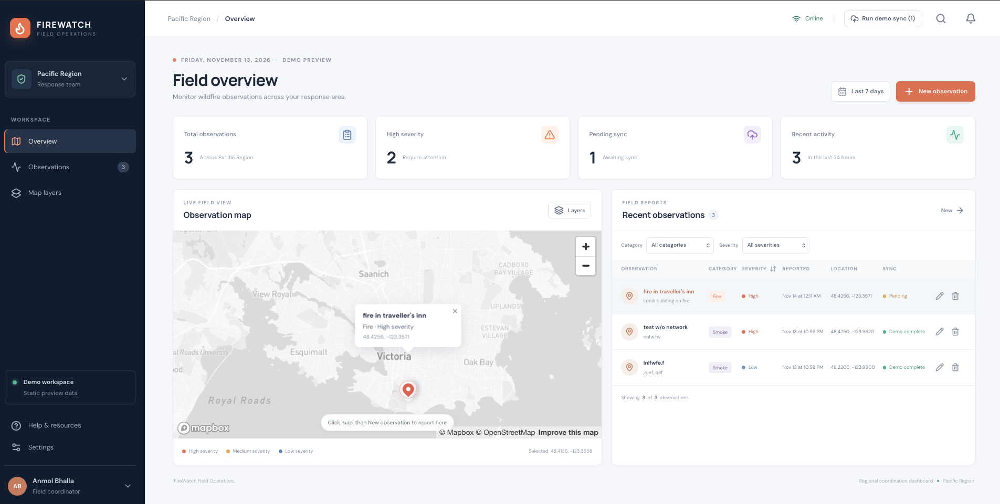
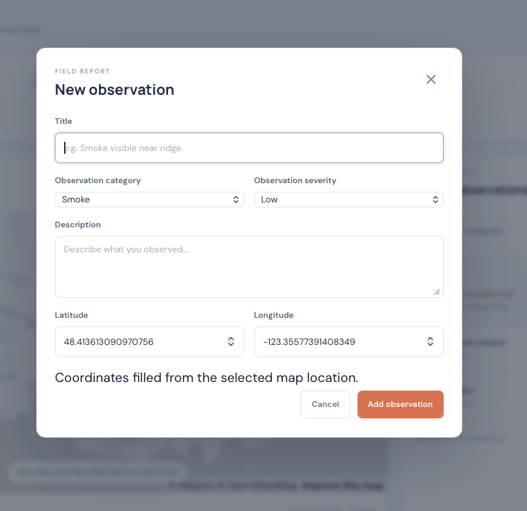
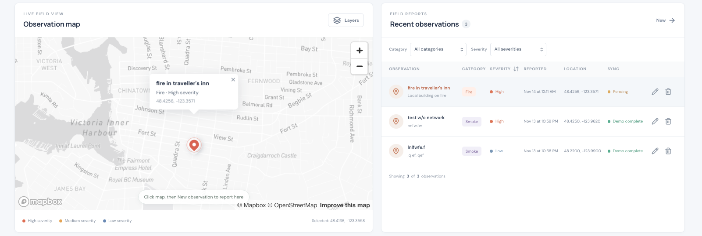
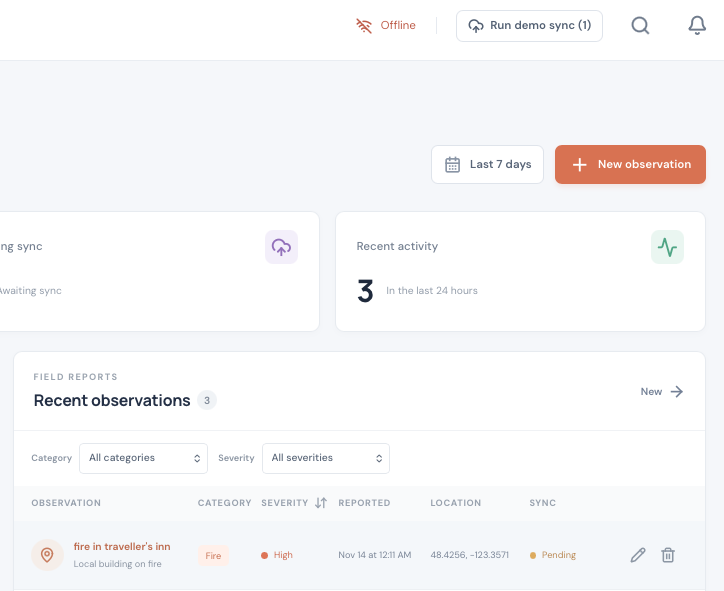

# FireWatch

**An offline-first wildfire observation dashboard — a full-stack-oriented frontend learning project exploring geospatial interfaces, local persistence, and connectivity-constrained workflows.**

FireWatch is a personal portfolio project I built to get hands-on experience with **Mapbox GL JS, Dexie, IndexedDB, and offline-first application architecture**. Inspired by the software challenges involved in wildfire field operations, it explores how observations can be recorded, visualized, and managed when network connectivity is unreliable.

The application is a **prototype using sample observations**, not an operational wildfire monitoring or emergency response system.

## Preview



_Interactive observation map, summary metrics, and field reports._

## Features

- **Interactive observation map:** View geolocated reports as severity-coded Mapbox markers, select observations, and choose coordinates directly from the map.
- **Observation management:** Create, edit, delete, and filter reports by category and severity.
- **Offline-first persistence:** Store observations locally using Dexie and IndexedDB, with data surviving page reloads.
- **Redux Toolkit state management:** Hydrate saved observations on startup and persist changes before updating application state.
- **PWA support:** Cache the production application shell and static assets for subsequent offline launches.
- **Connectivity and demo synchronization:** Display browser online/offline status and simulate synchronization locally, without contacting a backend.
- **Automated testing:** Cover observation logic, persistence, dashboard interactions, and key UI behavior using Vitest and React Testing Library.

## Screenshots

### Observation management



_Create a geolocated observation with a category, severity, description, and coordinates._

### Map interaction



_Select an observation to inspect its location and details._

### Offline workflow



_Previously cached application assets and locally stored observations remain accessible without connectivity. Mapbox tiles are not available offline._

## Tech stack

| Area              | Technologies                                  |
| ----------------- | --------------------------------------------- |
| Frontend          | React, TypeScript, Vite                       |
| UI                | Tailwind CSS, Lucide                          |
| State management  | Redux Toolkit, React Redux                    |
| Mapping           | Mapbox GL JS                                  |
| Local persistence | Dexie, IndexedDB                              |
| Offline support   | Vite PWA Plugin, Workbox                      |
| Testing           | Vitest, React Testing Library, fake-indexeddb |

## Getting started

Requires Node.js 20+ and npm.

```bash
git clone https://github.com/anmol-bhalla/firewatch-offline-field-dashboard.git
cd firewatch-offline-field-dashboard
npm install
cp .env.example .env
```

Add a public Mapbox access token to `.env`:

```env
VITE_MAPBOX_ACCESS_TOKEN=pk.your_public_mapbox_access_token
```

Start the development server:

```bash
npm run dev
```

The application can manage observations without a Mapbox token, but the interactive map requires a valid token and an internet connection.

## Testing and production preview

```bash
npm test
npm run lint
npm run build
npm run preview
```

To test offline functionality, open the production preview once while online, allow the application assets to cache, then disconnect from the network and reload.

Offline availability depends on the service worker having installed and cached the required assets successfully.

## Architecture

```text
src/
├── app/                   # Redux store, app composition, PWA and connectivity
├── features/
│   ├── dashboard/         # Dashboard UI and observation table
│   ├── map/               # Mapbox map, markers and selection
│   └── observations/      # Types, selectors, Redux logic and forms
├── services/
│   └── db/                # Dexie database and repository
└── styles/                # Application styles
```

**Persistence flow**

1. The app loads existing observations from IndexedDB into Redux.
2. A user creates, edits, or deletes an observation.
3. An asynchronous action writes the change to IndexedDB.
4. Redux is updated after the storage operation succeeds.
5. If loading or writing fails, the application displays an error instead of presenting an unpersisted change as successful.

Sample observations are seeded only when the local database is first created.

## Current limitations

FireWatch is intentionally scoped as a learning MVP.

- **No backend or real synchronization:** “Run demo sync” only changes local observation statuses to “Demo complete.”
- **No offline Mapbox tiles:** The application shell and observation data are available offline after caching, but map rendering requires connectivity.
- **No live wildfire data:** The application uses sample and user-created observations.
- **Local-only deletion:** Deleted observations are removed from IndexedDB; a future remote sync implementation would require an outbox or tombstones.
- **Device-local data:** Observations are stored in the browser and are not shared between devices.

## What I learned

This project gave me practical experience with:

- Designing a repository boundary between persistent storage and UI state.
- Handling asynchronous hydration, storage failures, and data consistency.
- Integrating an interactive map with application state.
- Understanding the difference between an offline-capable application shell and offline geospatial data.
- Testing persistence behavior independently of UI components.

## Future improvements

Potential extensions include a backend synchronization API, a durable operation outbox, conflict resolution, and offline map-region support.

---

**Project status:** Learning MVP / portfolio prototype.
